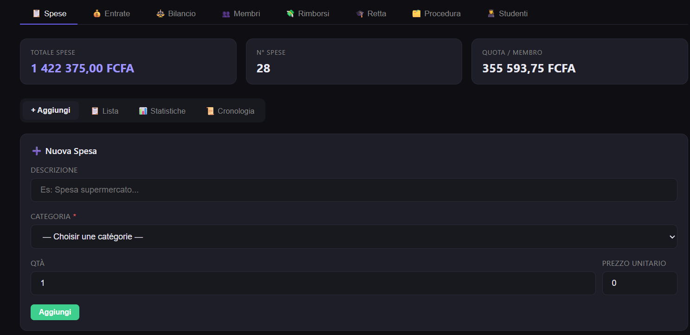
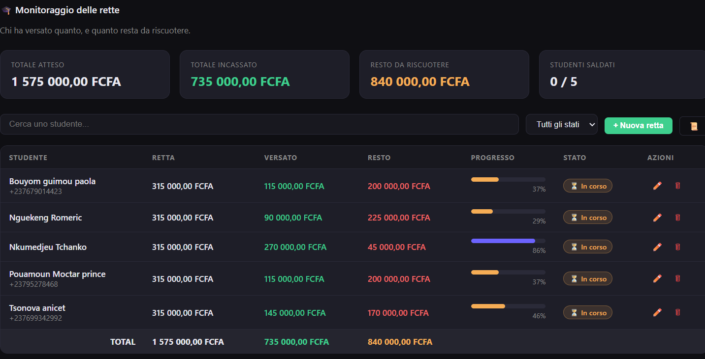
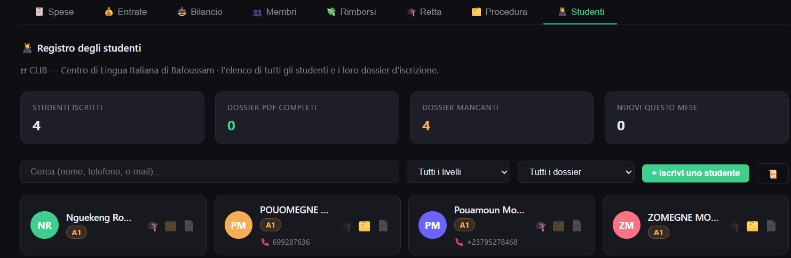
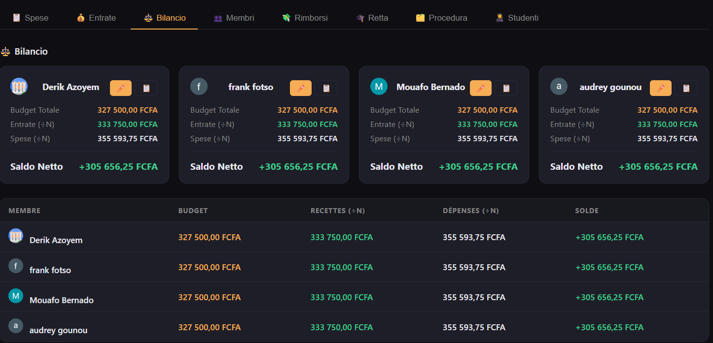
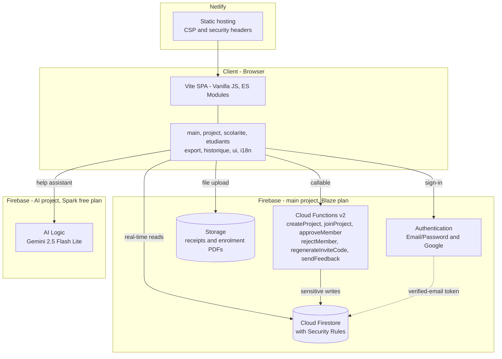

# 🤝 PartageTask

> SaaS platform for training-center administration and collaborative shared-expense management

[](https://app.netlify.com/projects/partagetask/deploys)


---

### 🌐 Live Demo → [partagetask.com](https://partagetask.com)

> 🚧 **Work in progress** — new features are being added regularly.

---

## 📸 Screenshots

| Expenses & summaries | Tuition tracking |
|:---:|:---:|
|  |  |
| **Student registry** | **Per-member balance** |
|  |  |

---

## 📋 Table of Contents

- [Overview](#overview)
- [Features](#features)
- [Tech Stack](#tech-stack)
- [Architecture](#architecture)
- [Installation](#installation)
- [Firebase Configuration](#firebase-configuration)
- [Security Rules](#security-rules)
- [Cloud Functions](#cloud-functions)
- [Deployment](#deployment)
- [Internationalization](#internationalization)
- [Testing](#testing)
- [Screenshots](#-screenshots)

---

## Overview

PartageTask ([partagetask.com](https://partagetask.com)) is a web-based management platform designed
for training centers. It brings administrative and secretarial activities together in a single
environment: a student registry, tuition-fee and procedure-fee receivables tracking, income and
expense recording, financial reporting and balance calculation. It also provides multiple
workspaces, invitations and role management, notifications, change history, a multilingual
interface and data export.

At its core, PartageTask lets a group of people manage shared money: create a project, invite
members, record expenses and revenues, and the app computes who owes what to whom.

**Use cases:**

- 🎓 **Training center** — student registry, tuition (Scolarité) and administrative-procedure
  (Procédure) receivables, cash-in tracking, official enrolment forms
- 📈 **Joint investment** — partners pooling funds, tracking revenues and expenses, consulting an
  automatic per-member balance sheet updated in real time
- 💸 **Shared expenses** — trips, shared housing, professional projects, family budgets
- 📒 **Shared activity log** — every expense and revenue is tracked with author, date, category and
  supporting documents (receipts/invoices), forming a complete, append-only record of all project
  operations

### Project types

The type is **mandatory at creation** and shapes the whole workspace (`src/dashboard.js`):

| Type | Behaviour |
|------|-----------|
| 💸 **Suivi des dépenses & règlements** | Shared expenses + automatic settlements between members. Revenues and the balance sheet are not used in this mode. |
| 📈 **Investissement (complet)** | Full mode: expenses, revenues, per-member balance sheet, settlements. |

In `depenses` mode, a Scolarité/Procédure instalment is recorded on its own, without generating a
linked revenue entry.

---

## Features

### 🔐 Authentication

- Google Sign-In (OAuth2)
- Email / Password login
- Duplicate email detection (one account per email)
- Password reset via email link
- Password change with reauthentication
- Automatic logout after 30 minutes of inactivity
- **Email verification required** — Firestore rules reject unverified accounts (`isVerified()`)

### 📊 Dashboard

- Real-time project list (Firestore `onSnapshot`)
- Create a project with name, description, currency and **project type**
- ⋮ menu on each project: delete (admin) or leave (member)
- Join a project via invitation code or URL link

### 🏗️ Project Space — 8 tabs

#### 📋 Expenses (`Dépenses`)

- Add with description, quantity, unit price and **mandatory category**
- 10 predefined categories + custom category (emoji + name)
- Edit and delete (admin only)
- Color-coded category badges on each row
- **Up to 2 receipts** per expense (PDF or images, max 10 MB)
  - Upload with progress bar
  - 👁 View button to open the receipt
  - Automatic replacement of the old receipt

#### 💰 Revenues (`Recettes`)

- Same structure as expenses with categories
- Equal split among all members (÷N)
- Not used in the `depenses` project type

#### ⚖️ Balance Sheet (`Bilan`)

- **Disabled by default** — manually activated by the admin
- On activation, enter each member's initial budget
- Anti-double-activation check
- Formula: `Balance = Budget + (Revenue ÷ N) − (Expenses ÷ N)`
- Budget +/− movements (admin) with full history
- Charts rendered from project data (`src/charts.js`)

#### 👥 Members (`Membres`)

- Invitation code with 7-day expiry
- Clickable invitation link (clipboard copy)
- Mandatory admin validation (`pendingMembers`)
- Code regeneration (admin)
- 🔴 badge for pending requests

#### 💸 Settlements (`Règlements`)

- Minimum rebalancing algorithm for N members
- Calculates exactly who owes what to whom
- Debt accumulates over time
- **Confirm receipt**: only the creditor can confirm
- Confirmed settlements are deducted from future debts
- History of completed settlements

#### 🎓 Scolarité & 🗂️ Procédure — receivables tracking

Two twin tabs built from a **single shared factory** (`createSuivi()` in `src/scolarite.js`), each
with its own Firestore collection (`etudiants` / `procedures`) and its own auto-revenue category
(📚 Éducation / 🗂️ Procédure).

- A tracked student carries a **ceiling amount** (`montantTotal`), set at creation and editable by
  the admin only
- Instalments (**avances**) progress the total and can **never exceed the ceiling** — enforced by a
  transaction that re-reads the running total and fails on overflow
- Progress bar, percentage, and `Soldé` / `En cours` status; once settled, no further instalment is
  accepted
- Each instalment **automatically generates a linked revenue** in the project (skipped in
  `depenses` mode)
- The admin can cancel an instalment — the linked revenue is removed with it
- Deleting a tracked student removes all its instalments and their revenues (irreversible,
  confirmation required)
- Students are never typed by hand here: they are **picked from the 👨‍🎓 registry**, the single
  source of identity
- Filters by text and status; live re-render on language change

#### 👨‍🎓 Students registry (`Étudiants`)

The identity directory for the center (`src/etudiants.js`, collection `registreEtudiants`).

- Enrolment form: name, sex, date of birth, phone, e-mail, address, **CECR Italian level**, session,
  notes
- CECR levels with color badges: A1 Débutant, A2 Élémentaire, B1 Intermédiaire, B2 Avancé,
  C1 Autonome, C2 Maîtrise (or *à évaluer*)
- **Enrolment file upload** — one scanned PDF per student to Firebase Storage (max 10 MB)
- **Generated enrolment form** — official PDF in the center's colors, produced client-side with
  jsPDF
- Student cards show a 📄 marker when the file is attached; filters by text, level and
  file-present/missing
- From a student's card, activate or open their 🎓 Scolarité and 🗂️ Procédure tracking directly

#### 📜 Change History

- Dedicated tab inside Expenses and Revenues
- Tracks all actions: ✅ `create`, ✏️ `edit`, 🗑 `delete`, plus `versement` and `annulation` for
  instalments
- Covers `tasks`, `recettes`, `etudiants`, `procedures` and `registreEtudiants`
- Displays before/after values for edits
- Filters by action type + text search
- Real-time via Firestore listener; **append-only** (no update, no delete, enforced by rules)

### 🤖 In-app AI assistant

- Help assistant answering **how to use PartageTask** only, in the user's own language
- Gemini `gemini-2.5-flash-lite` via `firebase/ai` (`GoogleAIBackend`)
- Runs on a **second, separate Firebase project** (`partagetask-ai`, free tier) so AI usage is never
  billed on the main Blaze project — auth, Firestore and Storage stay on `partagetask`
- Degrades gracefully: `isAssistantConfigured()` returns `false` when the AI config is absent

### 💬 Feedback / contact

- 💬 button in the dashboard and project header
- Categories: 🐛 bug, 💡 suggestion, 📩 other
- Delivered by e-mail through the `sendFeedback` Cloud Function (nodemailer + Secret Manager
  credentials), stored in the `feedbacks` collection

### 🔔 In-app Notifications

- Red badge with unread count
- Notifications for: new expense, new revenue, confirmed settlement
- Mark as read on click + "Mark all as read"
- Stored in `users/{uid}/notifications` (private per user)
- Real-time via Firestore listener

### 📁 Files & Receipts

- Upload to Firebase Storage
- Type validation (JPEG/PNG/WebP/HEIC + PDF) and size limit (max 10 MB), enforced in
  `storage.rules`
- 2 slots per expense/revenue, 1 enrolment file per student
- Old file deleted before replacement

### 📤 Exports

- **PDF**: full report (expenses, revenues, balance, budget history) — jsPDF
- **Excel**: 4 base sheets (Dépenses, Recettes, Bilan, Historique budgets) **plus Scolarités and
  Procédures sheets added automatically when the project tracks any** — `write-excel-file`

### 🌍 Internationalization

- 3 languages: Français (default), English, Italiano
- Automatic browser language detection, persisted in `localStorage` (`pt_lang`)
- Dynamic loading via `fetch('/langs/{lang}.json')` with in-memory cache and fallback to `fr`
- `pt:langchange` event so modules with dynamic content re-render live
- Language selector in the dashboard and project headers

### 🔒 Security

- All sensitive operations go through **Cloud Functions**
- Strict Firestore rules: membership check, admin check, **verified e-mail required**, and
  per-field payload validation on create/update
- History and confirmed settlements are **append-only** (no update, no delete)
- Invitation codes generated server-side only (never client-side)
- Admin validation before project access
- Hardened HTTP headers + full Content-Security-Policy (see [netlify.toml](#netlifytoml))
- HTML escaping (`escapeHtml`) and hex validation (`safeColor`) on client-supplied values such as
  custom category colors

---

## Tech Stack

| Layer | Technology |
|-------|------------|
| Frontend | Vite 8 + Vanilla JS (ES Modules) |
| Auth | Firebase Authentication |
| Database | Cloud Firestore |
| Storage | Firebase Storage |
| Functions | Firebase Cloud Functions v2 (`onCall`, Node.js 24) |
| AI | Firebase AI Logic — Gemini 2.5 Flash Lite (separate project) |
| PDF | jsPDF |
| Excel | write-excel-file |
| E-mail | nodemailer (in Cloud Functions) |
| Tests | Vitest |
| Hosting | Netlify |

**Supported currencies:** FCFA, EUR, USD, GBP, XOF, MAD

---

## Architecture

### Runtime overview

How the deployed components interact at runtime:


```
partagetask/
├── partagetask-app/           # Frontend (this package)
└── partagetask-functions/     # Firebase project + Cloud Functions
    ├── firebase.json
    ├── firestore.rules
    ├── storage.rules
    └── functions/
        ├── index.js           # All 6 callable functions
        └── package.json       # Node.js 24 engine
```
The GitHub repository holds two sibling packages:

### `partagetask-app/`

```
partagetask-app/
├── index.html              # HTML entry point (all screens & modals)
├── vite.config.js          # Vite configuration
├── netlify.toml            # Netlify config (redirects + security headers + CSP)
├── firebase.json           # Firestore / Storage rules deployment
├── firestore.rules         # Firestore security rules (300 lines)
├── storage.rules           # Storage security rules
├── package.json
├── public/
│   ├── favicon.svg
│   ├── icons.svg
│   └── langs/              # Translation files
│       ├── fr.json
│       ├── en.json
│       └── it.json
├── src/
│   ├── main.js             # JS entry point, event listeners, auth state
│   ├── firebase.js         # Firebase init + Cloud Function callables
│   ├── firebase-ai.js      # 2nd Firebase app ('ai') + Gemini model
│   ├── assistant.js        # In-app AI help assistant
│   ├── auth.js             # Login / Register / Logout / ForgotPw / ChangePw
│   ├── dashboard.js        # Project list, create, join, delete, leave
│   ├── project.js          # Expenses, revenues, balance, members, settlements
│   ├── scolarite.js        # Receivables factory → Scolarité + Procédure tabs
│   ├── etudiants.js        # Students registry, enrolment file, generated PDF
│   ├── historique.js       # Change history rendering & filters
│   ├── admin.js            # Member approval, budget movements
│   ├── charts.js           # Balance-sheet charts
│   ├── categories.js       # Expense/revenue categories
│   ├── notifications.js    # Real-time in-app notifications
│   ├── files.js            # Firebase Storage upload
│   ├── export.js           # PDF (jsPDF) and Excel (write-excel-file)
│   ├── ui.js               # DOM cache ($), toast, modals, navigation, fmt()
│   ├── i18n.js             # Dynamic language loading + applyTranslations()
│   ├── inactivity.js       # Auto-logout after 30 min (debounce)
│   ├── styles.css          # All CSS (dark theme)
│   └── assets/
└── tests/
    ├── scolarita.test.js       # Receivables / ceiling / instalment logic
    ├── summary-parity.test.js  # Summary totals parity
    └── ui.test.js              # escapeHtml, safeUrl, fmt, initials, colorForUid
```

### Firestore data model

```
users/{uid}
  └── notifications/{notifId}
feedbacks/{feedbackId}
projects/{projectId}
  ├── tasks/{taskId}                  # expenses
  ├── recettes/{recetteId}            # revenues
  ├── history/{histId}                # append-only change log
  ├── pendingMembers/{uid}
  ├── budgetMovements/{memberUid}
  │     └── movements/{movId}
  ├── registreEtudiants/{etuId}       # student identity registry
  ├── etudiants/{etudiantId}          # Scolarité tracking
  │     └── versements/{versementId}
  ├── procedures/{etudiantId}         # Procédure tracking
  │     └── versements/{versementId}
  └── settlementsConfirmed/{settlementId}
```

---

## Installation

### Prerequisites

- Node.js v22.12+ for the frontend — **Node.js 24** for the Cloud Functions runtime
- Firebase account (Blaze plan for Cloud Functions)
- Netlify account (free)

### 1. Clone the repository

```bash
git clone https://github.com/derikazoyem/partagetask.git
cd partagetask
```

### 2. Install frontend dependencies

```bash
cd partagetask-app
npm install
```

### 3. Install Cloud Functions dependencies

```bash
cd partagetask-functions/functions
npm install
```

### 4. Run in development

```bash
cd partagetask-app
npm run dev
```

Open [http://localhost:5173](http://localhost:5173)

---

## Firebase Configuration

### 1. Create the main Firebase project

1. Go to [console.firebase.google.com](https://console.firebase.google.com)
2. Create a new project
3. Enable **Authentication** → Email/Password + Google
4. Create a **Firestore** database (production mode)
5. Enable **Storage**
6. Upgrade to the **Blaze** plan (required for Cloud Functions)

### 2. Set up credentials

Edit `src/firebase.js`:

```javascript
const firebaseConfig = {
  apiKey: 'YOUR_API_KEY',
  authDomain: 'YOUR_PROJECT.firebaseapp.com',
  projectId: 'YOUR_PROJECT_ID',
  storageBucket: 'YOUR_PROJECT.firebasestorage.app',
  messagingSenderId: 'YOUR_SENDER_ID',
  appId: 'YOUR_APP_ID'
}
```

Cloud Functions are called in region `us-central1`.

### 3. (Optional) Create the AI project for the assistant

The assistant deliberately runs on a **second Firebase project on the free Spark plan**, so Gemini
usage is never billed on the Blaze project.

1. Create a new Firebase project (no billing)
2. Enable **AI Logic → Gemini Developer API**
3. Register a Web app and paste its config into `src/firebase-ai.js`

Leave the placeholders in place to ship without the assistant — `isAssistantConfigured()` returns
`false` and the feature stays hidden.

### 4. Deploy rules and Cloud Functions

```bash
# Firestore + Storage rules (from partagetask-app/)
firebase deploy --only firestore:rules,storage

# Cloud Functions (from partagetask-functions/)
firebase login
firebase use YOUR_PROJECT_ID
firebase deploy --only functions
```

`sendFeedback` reads its SMTP credentials from Secret Manager:

```bash
firebase functions:secrets:set GMAIL_USER
firebase functions:secrets:set GMAIL_APP_PASSWORD
```

### 5. Authentication — Important settings

- **Account linking** → "Link accounts that use the same email address"
- **Authorized domains** → Add `localhost` and your Netlify domain
- E-mail verification must be enabled: the Firestore rules reject unverified accounts

---

## Security Rules

The authoritative rules live in [`firestore.rules`](firestore.rules) (300 lines) and
[`storage.rules`](storage.rules). They are **not reproduced in full here on purpose** — read the
files, they are the source of truth.

Shape of the Firestore rules:

```
function isAuth()       → request.auth != null
function isVerified()   → isAuth() && request.auth.token.email_verified
function isMember(pid)  → isVerified() && uid in projectDoc(pid).data.members
function isAdmin(pid)   → isVerified() && projectDoc(pid).data.adminUid == uid
```

| Path | Read | Write |
|------|------|-------|
| `users/{uid}` (+ `notifications`) | owner | owner (any authed user may *create* a notification) |
| `feedbacks/{id}` | — | authed create only |
| `projects/{pid}` | member | admin, or member for the allowed fields |
| `tasks`, `recettes` | member | member create (validated payload), admin update/delete |
| `registreEtudiants` | member | validated payload, admin for destructive ops |
| `etudiants`, `procedures` (+ `versements`) | member | validated payload; instalments capped by the ceiling in a transaction |
| `budgetMovements` (+ `movements`) | member | admin |
| `pendingMembers` | admin | self-create, admin update/delete |
| `history` | member | member **create only** — no update, no delete |
| `settlementsConfirmed` | member | member **create only** — no update, no delete |

Every create/update on business collections goes through a `valid*Fields()` function checking types,
required fields and string length caps — the client cannot write arbitrary documents.

Storage: files under `projects/{projectId}/**` are readable and deletable by project members, and
writable only when ≤ 10 MB with a content type matching `image/(jpeg|jpg|png|webp|heic)` or
`application/pdf`.

---

## Cloud Functions

All functions are v2 `onCall` handlers (`partagetask-functions/functions/index.js`):

| Function | Description |
|----------|-------------|
| `createProject` | Creates project + invitation code (atomic) |
| `joinProject` | Validates code, creates a `pendingMembers` request |
| `approveMember` | Admin approves → adds to `members` |
| `rejectMember` | Admin rejects → removes from pending |
| `regenerateInviteCode` | Generates a new 7-day code |
| `sendFeedback` | Sends user feedback by e-mail (nodemailer + secrets) |

Exposed to the client as callables in `src/firebase.js`: `fnCreateProject`, `fnJoinProject`,
`fnApproveMember`, `fnRejectMember`, `fnRegenerateInviteCode`, `fnSendFeedback`.

---

## Deployment

### Production build

```bash
cd partagetask-app
npm run build
```

Vite targets ES2020 and splits Firebase into its own chunk (`manualChunks`).

### Deploy to Netlify

**Option A — Drag and drop:** drag the `dist/` folder to [netlify.com](https://netlify.com)

**Option B — Netlify CLI:**

```bash
npm install -g netlify-cli
netlify deploy --prod --dir=dist
```

### netlify.toml

```toml
[build]
  command = "npm run build"
  publish = "dist"

[[headers]]
  for = "/*"
  [headers.values]
    Cross-Origin-Opener-Policy    = "same-origin-allow-popups"
    Cross-Origin-Embedder-Policy  = "unsafe-none"
    X-Content-Type-Options        = "nosniff"
    X-Frame-Options               = "DENY"
    Referrer-Policy               = "strict-origin-when-cross-origin"
    Permissions-Policy            = "camera=(), microphone=(), geolocation=()"
    Strict-Transport-Security     = "max-age=63072000; includeSubDomains; preload"
    Content-Security-Policy       = "default-src 'self'; script-src 'self' https://apis.google.com https://www.gstatic.com; style-src 'self' 'unsafe-inline'; img-src 'self' data: blob: https://*.googleapis.com https://*.googleusercontent.com https://firebasestorage.googleapis.com; connect-src 'self' https://*.googleapis.com https://*.firebaseio.com https://*.cloudfunctions.net wss://*.firebaseio.com; frame-src https://partagetask.firebaseapp.com https://partagetask-ai.firebaseapp.com https://accounts.google.com; frame-ancestors 'none'; object-src 'none'; base-uri 'self'"

[[redirects]]
  from = "/*"
  to = "/index.html"
  status = 200
```

> The `frame-src` directive must list both Firebase auth domains (main project **and** AI project),
> otherwise Google Sign-In or the assistant gets blocked.

---

## Internationalization

Translation files live in `public/langs/`. Supported languages are declared in one place:
`SUPPORTED_LANGS` in `src/i18n.js`.

To add a new language:

1. Create `public/langs/xx.json` by copying `fr.json`
2. Translate all values
3. Add `'xx'` to `SUPPORTED_LANGS` in `src/i18n.js`
4. Add a `.lang-opt` entry with `data-lang="xx"` to **both** language dropdowns in `index.html`
   (`#lang-dropdown` and `#lang-dropdown-app`)

> **RTL is not supported yet.** `applyTranslations()` currently sets
> `document.documentElement.dir = 'ltr'` unconditionally. Adding Arabic or Hebrew means making that
> direction depend on the active language and auditing the CSS for logical properties.

Markup is translated through three hooks: `data-i18n` (text content), `data-i18n-ph` (placeholder)
and `data-i18n-title` (title), plus a legacy `id="t-*"` convention.

---

## Expense Categories

Predefined categories in `src/categories.js`:

| Emoji | Category (fr) | id | Color |
|-------|---------------|-----|-------|
| 🍔 | Alimentation | `food` | `#f6ad55` |
| 🚗 | Transport | `transport` | `#63b3ed` |
| 🏠 | Logement | `housing` | `#68d391` |
| 🎉 | Loisirs | `leisure` | `#b794f4` |
| 💊 | Santé | `health` | `#fc8181` |
| 📚 | Éducation | `education` | `#4fd1c5` |
| 👔 | Vêtements | `clothes` | `#f687b3` |
| 💡 | Factures | `bills` | `#faf089` |
| 🛒 | Courses | `groceries` | `#9ae6b4` |
| 🔧 | Divers | `other` | `#a0aec0` |

Users can create custom categories with their own emoji and name (`id: 'custom'`). Custom colors are
client-supplied and therefore re-validated with `safeColor()` before being injected into markup.

---

## Testing

```bash
npm test            # vitest run
npm run test:watch
```

Current suite: **46 tests across 3 files** in `tests/` — receivables and ceiling logic, summary
totals parity, and UI helpers (`escapeHtml`, `safeUrl`, `fmt`, `initials`, `colorForUid`).

---

## License

© 2026 Derik Azoyem — All Rights Reserved
Unauthorized copying, modification, distribution or commercial use
of this software, via any medium, is strictly prohibited without
prior written permission from the author.

---

## Author

**Derik Azoyem**

- Email: dazoyem@gmail.com
- GitHub: [@derikazoyem](https://github.com/derikazoyem)

---

> Built with ❤️ to simplify shared expense management
